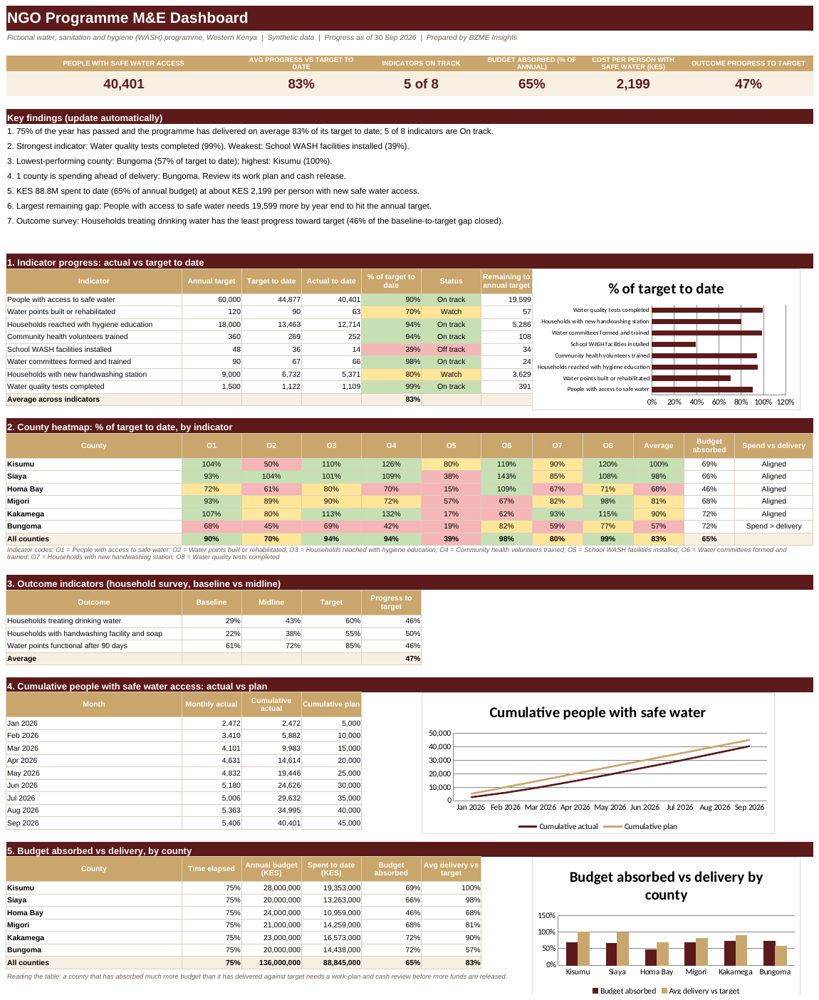

# NGO Programme M&E Dashboard
**Sector:** NGO / Development  |  **Tool:** Excel  |  **Data:** synthetic

> All data in this project is synthetic and generated for demonstration. Targets, rates and thresholds are illustrative.

## Dashboard preview

## Business question
Is a donor-funded water and hygiene programme on track against its annual targets, which counties and indicators are lagging, and does spending match delivery?

## Data
Monthly results for 8 output indicators across 6 counties (Jan to Sep 2026), annual targets by county, budget and spend by county and quarter, and baseline, midline and target values for 3 outcome indicators.

## What I built
- Target-to-date and status (On track, Watch, Off track) for every indicator, with editable thresholds
- County heatmap of progress against target, by indicator
- Budget absorbed versus delivery by county, with a spend-versus-delivery flag
- Outcome progress from baseline to target (household survey)
- Cumulative trend against plan and automatic key findings for the donor report

## Key results (from the workbook)
- 40,401 people reached with safe water access, 90% of the target to date, with 75% of the year elapsed
- Average delivery is 83% of target to date; 5 of 8 indicators are On track
- School WASH facilities installed is the weakest indicator at 39%; Water points built or rehabilitated, Households with new handwashing station are on Watch
- Bungoma has the lowest county delivery (57%) while Kisumu leads (100%)
- Bungoma is spending ahead of delivery (flagged on the dashboard)
- KES 88.8M spent (65% of the KES 136M annual budget), about KES 2,199 per person with safe water access
- Outcome survey: on average 47% of the baseline-to-target gap is closed; the least progress is on households treating drinking water

## Skills shown
Excel (SUMIFS, AVERAGEIFS, INDEX/MATCH, conditional formatting), M&E indicator design, donor reporting, dashboard design

## Files
- [NGO_Programme_ME_Portfolio.xlsx](NGO_Programme_ME_Portfolio.xlsx): the Excel workbook (open it and change the **Assumptions** sheet to see the dashboard update)
- [docs/BZME_08_NGO_Programme_ME_Project_Guide.docx](docs/BZME_08_NGO_Programme_ME_Project_Guide.docx): project write-up explaining how it works

## How to explore
1. Download the workbook and open the **Dashboard** sheet.
2. Open **Assumptions**, change the as-of date or a status threshold, and watch the dashboard update.
3. Click any dashboard number and trace it back through the calculation sheets to the raw data.

---
Built by Madikizelah (Maddie) Nduta | BZME Insights | [LinkedIn](https://www.linkedin.com/in/maddie-nduta)
