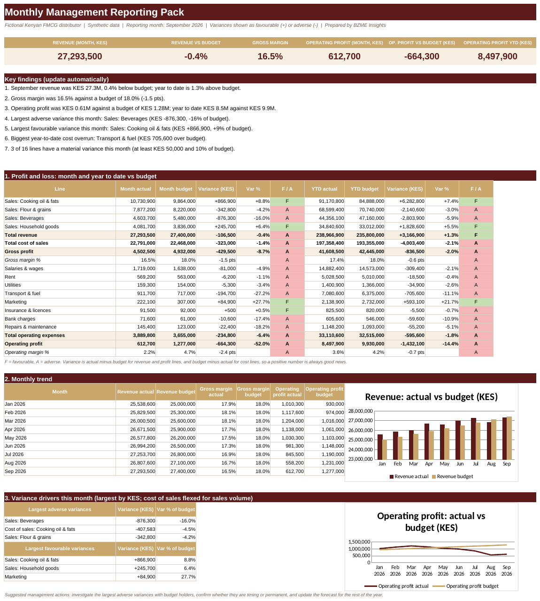

# Monthly Management Reporting Pack
**Sector:** Finance / Management reporting  |  **Tool:** Excel  |  **Data:** synthetic

> All data in this project is synthetic and generated for demonstration. Targets, rates and thresholds are illustrative.

## Dashboard preview

## Business question
How did the business perform against budget this month and year to date, which accounts drive the variances, and which of them are material enough to explain?

## Data
A ledger of about 1,300 transactions across 16 accounts (Jan to Sep 2026) and a monthly budget for every account, for a fictional Kenyan FMCG distributor.

## What I built
- Monthly and year-to-date profit and loss against budget, with favourable and adverse flags
- A reporting-month selector: change one cell and the whole pack rolls forward
- Materiality rules (KES amount and percentage) that decide which variances need an explanation
- Variance drivers, with cost of sales flexed for sales volume so a drop in sales does not look like a cost saving
- Automatic key findings, monthly trend charts and a one-page printable pack

## Key results (from the workbook)
- September revenue KES 27.3M, -0.4% against budget; year to date +1.3%
- Gross margin 16.5% against a budget of 18.0% (-1.5 points), down from 17.9% in January
- Operating profit KES 0.61M against a budget of KES 1.28M (-52%); year to date KES 8.5M against KES 9.9M (-14.4%)
- Largest adverse variances: Sales: Beverages (KES -876,300, -16%) and Cost of sales: Cooking oil & fats (KES -407,583, -4.5%, flexed for volume)
- Transport & fuel is KES 705,600 over budget year to date and 27% over budget in September; Marketing is KES 593,100 under budget year to date
- 3 of 16 lines have a material variance this month (at least KES 50,000 and 10% of budget)

## Skills shown
Excel (SUMIFS, EDATE, INDEX/MATCH, SMALL/LARGE, conditional formatting), budget-vs-actual and variance analysis, management reporting

## Files
- [Monthly_Management_Pack_Portfolio.xlsx](Monthly_Management_Pack_Portfolio.xlsx): the Excel workbook (open it and change the **Assumptions** sheet to see the pack update)
- [docs/Sample_Management_Pack_Sep_2026.pdf](docs/Sample_Management_Pack_Sep_2026.pdf): the September 2026 pack exported as a PDF
- [docs/BZME_09_Monthly_Management_Reporting_Project_Guide.docx](docs/BZME_09_Monthly_Management_Reporting_Project_Guide.docx): project write-up explaining how it works

## How to explore
1. Download the workbook and open the **Dashboard** sheet.
2. Open **Assumptions**, change the reporting month to August or June, and watch every number and finding update.
3. Click any dashboard number and trace it through **Monthly_PL** back to the ledger and budget.

---
Built by Madikizelah (Maddie) Nduta | BZME Insights | [LinkedIn](https://www.linkedin.com/in/maddie-nduta)
