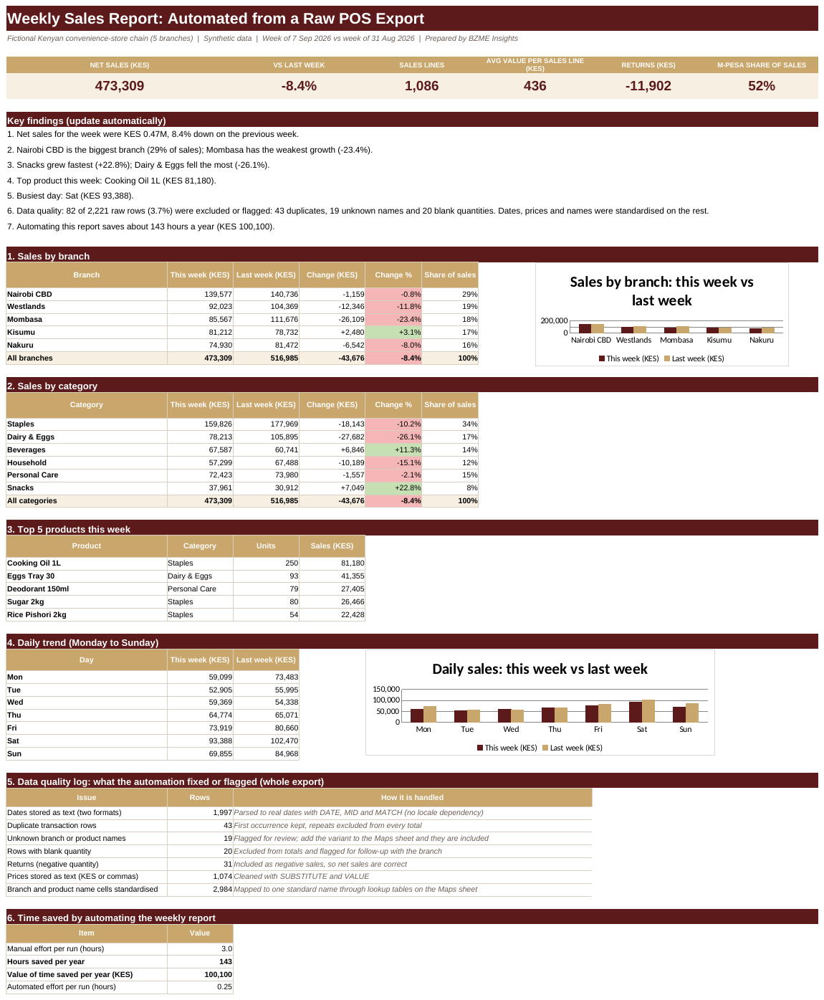

# Weekly Sales Report Automation
**Sector:** Retail / Reporting automation  |  **Tool:** Excel (formulas) + VBA macro file  |  **Data:** synthetic

> All data in this project is synthetic and generated for demonstration. Targets, rates and thresholds are illustrative.

## Dashboard preview

## Business question
Can a weekly sales report that takes hours of manual cleaning be rebuilt so that pasting in a new POS export refreshes everything, with a log showing what was fixed?

## Data
A deliberately messy POS export of 2,221 rows for 5 branches and 30 products over two weeks (31 Aug to 13 Sep 2026): mixed date formats, text prices, name variants, duplicates, returns and blank quantities.

## What I built
- Formula-based cleaning of dates, prices, branch, product and payment names, with lookup tables you can extend
- Duplicate, unmapped-name, blank-quantity and return handling, with an Include flag that drives every total
- A weekly report: branch, category, top products and daily trend, each against the previous week
- A data-quality log so the reader can see what was fixed, excluded or flagged
- A time-saved calculator, and a VBA macro that imports the CSV, refreshes and exports the report as a PDF

## Key results (from the workbook)
- Net sales KES 473,309 for the week of 7 Sep 2026, -8.4% on the previous week
- Mombasa has the weakest growth (-23.4%); Kisumu is strongest (+3.1%)
- Snacks grew fastest (+22.8%); Dairy & Eggs fell the most (-26.1%)
- 82 of 2,221 raw rows (3.7%) were excluded or flagged: 43 duplicates, 19 unknown names and 20 blank quantities; 31 returns were netted off sales
- 1,997 text dates and 1,074 text prices were converted automatically, and branch and product names were standardised through lookup tables
- About 143 hours (KES 100,100) saved per year at 3 hours manual vs 15 minutes automated per weekly run (illustrative inputs)

## Skills shown
Excel (nested text, date and lookup formulas, SUMIFS, SUMPRODUCT, INDEX/MATCH), data cleaning, VBA automation, reporting design

## Files
- [Reporting_Automation_Portfolio.xlsx](Reporting_Automation_Portfolio.xlsx): the Excel workbook (paste a new export into **Raw_Export** and the report refreshes)
- [data/raw_pos_export_2026-09-14.csv](data/raw_pos_export_2026-09-14.csv): the raw export as a CSV, for the macro to import
- [automation/RefreshReport.bas](automation/RefreshReport.bas): VBA module that imports the CSV, refreshes the report and exports a PDF
- [docs/BZME_10_Reporting_Automation_Project_Guide.docx](docs/BZME_10_Reporting_Automation_Project_Guide.docx): project write-up explaining how it works

## How to explore
1. Download the workbook and open the **Dashboard** sheet, then read the data-quality log.
2. Open **Raw_Export** and **Clean** side by side to see how a messy row becomes a clean one.
3. On **Maps**, add a new product name variant, and watch an unmapped row move into the totals after a refresh.
4. To run the macro: save a copy of the workbook as .xlsm, press Alt+F11, choose File > Import File, select `RefreshReport.bas`, then run `RunWeeklyReport` and pick the CSV.

---
Built by Madikizelah (Maddie) Nduta | BZME Insights | [LinkedIn](https://www.linkedin.com/in/maddie-nduta)
