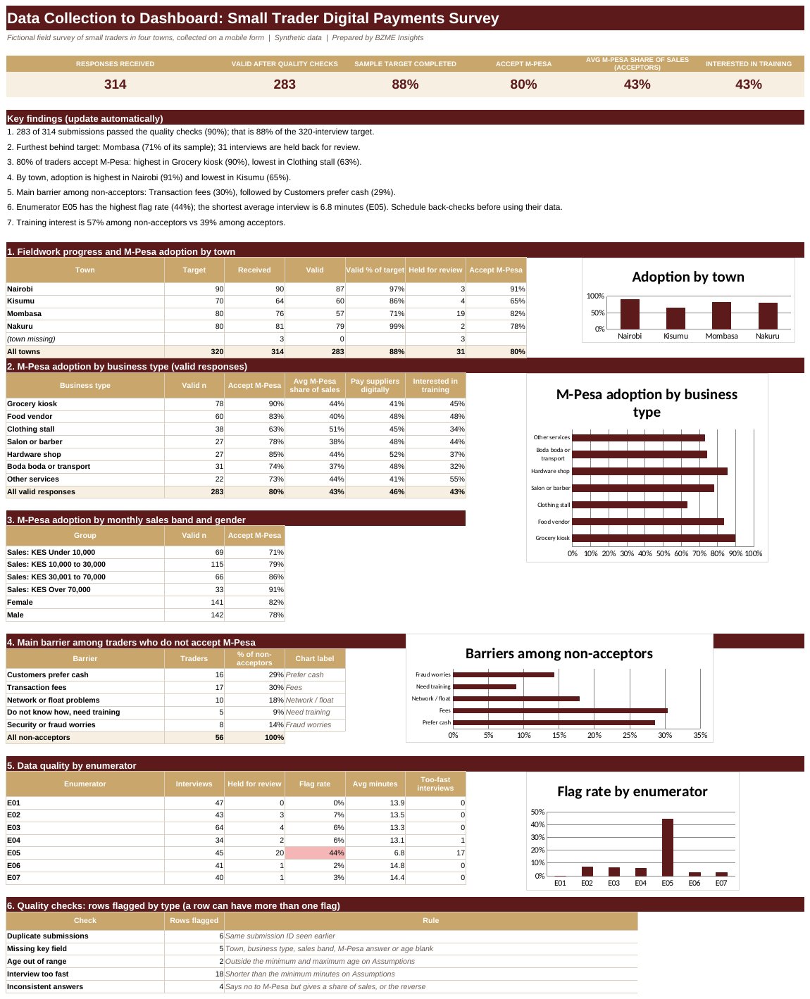

# Data Collection to Dashboard: Small Trader Digital Payments Survey
**Sector:** Research / NGO data collection  |  **Tool:** KoboToolbox / XLSForm + Excel  |  **Data:** synthetic

> All data in this project is synthetic and generated for demonstration. Targets, rates and thresholds are illustrative.

## Dashboard preview

## Business question
Can field data be collected on a mobile form, checked for quality as it arrives, and turned into a dashboard that shows fieldwork progress and early findings?

## Data
A survey form of about 20 questions (XLSForm) and 314 synthetic submissions from 7 enumerators in 4 towns, including deliberate problems: duplicates, missing values, impossible ages, rushed interviews and inconsistent answers.

## What I built
- A data collection form in XLSForm format, with skip logic, answer constraints and required fields, ready to upload to KoboToolbox or ODK
- Automatic quality checks on every submission (duplicates, missing fields, age range, interview length, inconsistent answers)
- A fieldwork tracker: valid interviews against the planned sample by town
- Analysis of valid responses only: adoption by town, business type, sales band and gender, and barriers to adoption
- A quality scorecard by enumerator to decide where back-checks are needed

## Key results (from the workbook)
- 283 of 314 submissions passed the quality checks (90%), which is 88% of the 320-interview target; 31 are held for review
- Quality problems found: 6 duplicates, 5 missing key fields, 2 impossible ages, 18 too-fast interviews and 4 inconsistent answers
- Enumerator E05 has a 44% flag rate and averages 6.8 minutes per interview, so its data needs back-checks before it is used
- Mombasa is furthest behind its sample target (71%), mainly because of held-back interviews
- 80% of valid respondents accept M-Pesa: highest in grocery kiosk (90%) and lowest in clothing stall (63%); by town, Nairobi leads (91%) and Kisumu trails (65%)
- Main barriers among non-acceptors: transaction fees (30%) and customers prefer cash (29%); 43% of respondents want training

## Skills shown
Survey design (XLSForm), data quality assurance, Excel (COUNTIFS, AVERAGEIFS, INDEX/MATCH, conditional formatting), fieldwork monitoring, dashboard design

## Files
- [Data_Collection_Dashboard_Portfolio.xlsx](Data_Collection_Dashboard_Portfolio.xlsx): the Excel workbook (change the **Assumptions** sheet to see the checks and dashboard update)
- [kobo/Survey_Form_XLSForm.xlsx](kobo/Survey_Form_XLSForm.xlsx): the survey form, in XLSForm format
- [data/survey_responses.csv](data/survey_responses.csv): the synthetic submissions as a CSV
- [docs/BZME_11_Data_Collection_Dashboard_Project_Guide.docx](docs/BZME_11_Data_Collection_Dashboard_Project_Guide.docx): project write-up explaining how it works

## How to explore
1. Download the workbook and open the **Dashboard** sheet, then read the quality scorecard by enumerator.
2. Open **Quality_Checks** next to **Responses** to see which rows were flagged and why.
3. On **Assumptions**, change the minimum interview length or age limits and watch the flags and results update.
4. To try the form: in KoboToolbox choose New project > Upload an XLSForm, and select `kobo/Survey_Form_XLSForm.xlsx`.

---
Built by Madikizelah (Maddie) Nduta | BZME Insights | [LinkedIn](https://www.linkedin.com/in/maddie-nduta)
