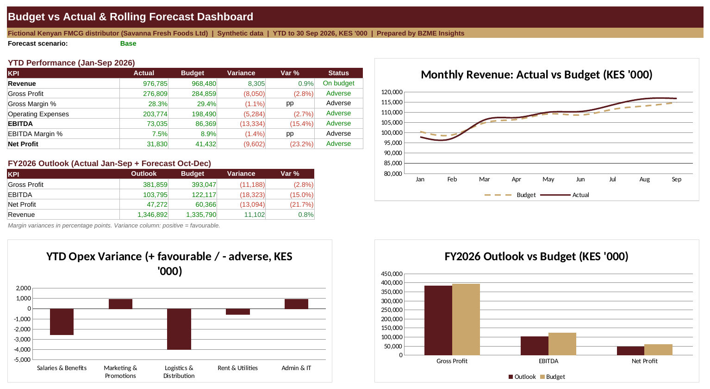

# FP&A Budget vs Actual and Rolling Forecast
**Sector:** Finance / FP&A  |  **Tool:** Excel  |  **Data:** synthetic

> All data in this project is synthetic and generated for demonstration. Budgets, targets and scenario assumptions are illustrative.

## Dashboard preview

## Business question
Revenue is on budget, so why is profit short, which lines explain the gap, and how will the full year finish under different scenarios?

## Data
12 months of budget (Jan to Dec 2026) and 9 months of actuals (Jan to Sep 2026) for a fictional Kenyan FMCG distributor, with 3 revenue segments and 5 operating cost lines.

## What I built
- Monthly P&L from revenue to net profit for budget, actuals and forecast
- Variance analysis with favourable/adverse flags and driver comments
- Rolling forecast (Oct to Dec) with Base, Upside and Downside scenarios
- Dashboard with KPIs, charts and key findings that update automatically

## Key results (from the workbook)
- Revenue is 0.9% above budget year to date, but EBITDA is 15.4% below budget (gross margin 28.3% vs 29.4%)
- Wholesale grew about 5.2%; e-commerce (-7.5%) and retail (-2.4%) fell short
- Logistics ran about 8% over budget (fuel and longer routes); marketing was under budget
- Base-case full-year net profit is forecast at about 22% below budget (KES 47.3M vs 60.4M)

## Skills shown
Excel (IF, SUM, INDEX/MATCH, MAX, data validation, charts, conditional formatting), variance analysis, FP&A forecasting, scenario modelling

## Files
- [FPA_Budget_vs_Actual_Portfolio.xlsx](FPA_Budget_vs_Actual_Portfolio.xlsx): the Excel workbook (open it and change the scenario on the **Assumptions** sheet, cell B18, to see the dashboard update)
- [docs/BZME_12_FPA_Budget_vs_Actual_Project_Guide.docx](docs/BZME_12_FPA_Budget_vs_Actual_Project_Guide.docx): project write-up explaining how it works

## How to explore
1. Download the workbook and open the **Dashboard** sheet.
2. Open **Assumptions**, change the scenario to Downside, and watch the dashboard update.
3. Click any dashboard number and trace it back through the Variance and Forecast sheets to the Budget and Actuals.

---
Built by Madikizelah (Maddie) Nduta | BZME Insights | [LinkedIn](https://www.linkedin.com/in/maddie-nduta)
